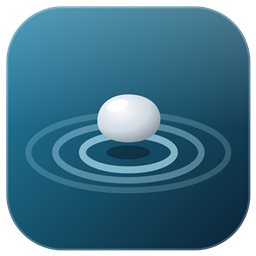
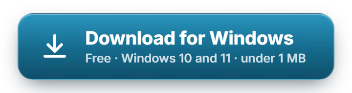
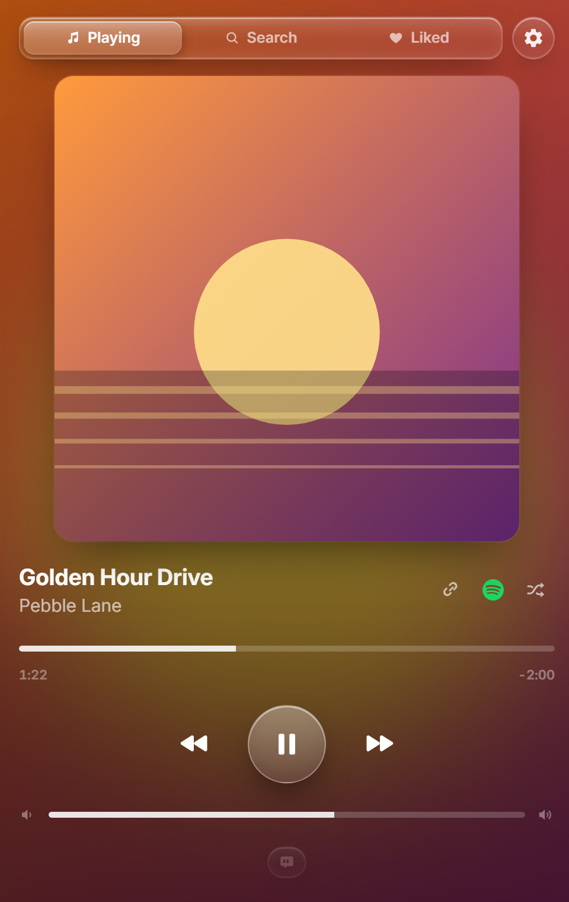
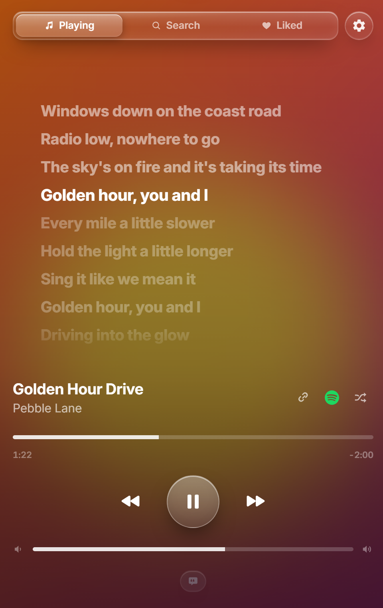
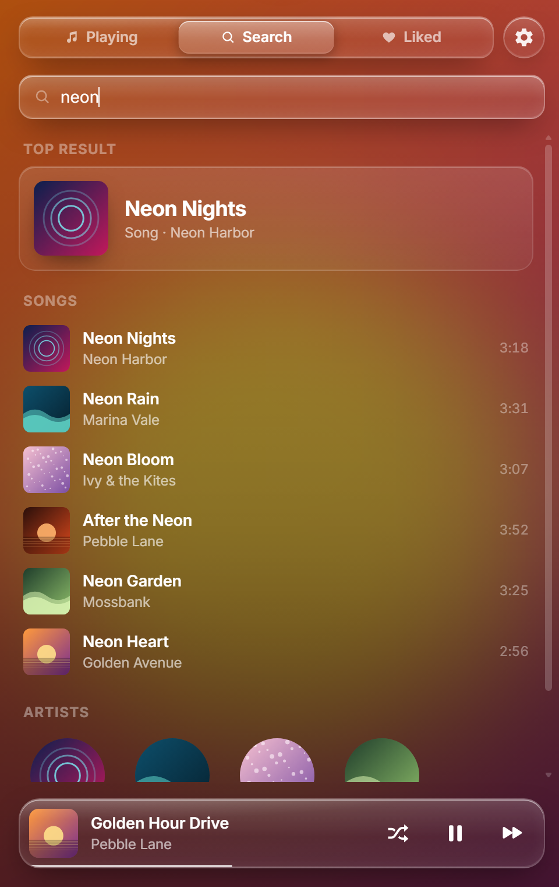
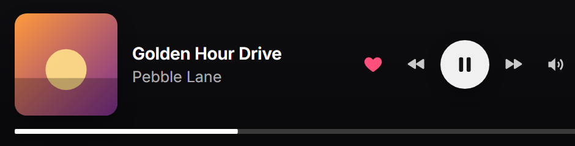

# PebblePlayer

**A small, good-looking Spotify player for Windows that uses a fraction of the memory.**

 

Always the newest version · <a href="https://github.com/saintzdid12/pebble/releases/latest">Release notes</a> · <a href="https://github.com/saintzdid12/pebble/releases">All versions</a>

  

&nbsp;
&nbsp;

Now playing&nbsp;&nbsp;·&nbsp;&nbsp;Synced lyrics&nbsp;&nbsp;·&nbsp;&nbsp;Search

## Why PebblePlayer

- **Light.** One small app, under 1 MB, using far less memory than the regular Spotify app. Easy on games and streams.
- **Clean.** Glass design that takes its colors from the album art. No ads, no clutter.
- **Synced lyrics** that load fast, plus lyrics for the next songs ready before they play.
- **Mini player** that floats on top while you work or game.
- **Listening parties.** Listen together with friends, take turns picking songs, or let Party Mix pick from everyone's likes.
- **A queue that works like Spotify's**, plus your own music files from this PC.
- **Festive mode** for the holidays: lights, snow and a Holiday tab, all switchable.

 
The mini player

## Install

1. **[Download PebblePlayer.exe](https://github.com/saintzdid12/pebble/releases/latest/download/PebblePlayer.exe)** and open it.
2. If Windows shows **"Windows protected your PC"**, click **More info**, then **Run anyway**.
   This shows up because PebblePlayer is a small app from an independent developer, not because anything is wrong.
3. Click **Yes** to install. PebblePlayer adds itself to your Desktop and Start menu and opens.
4. Follow the short setup in the app: sign in with Spotify and make your free Spotify key (about 2 minutes, only once).

**You'll need:** Windows 10 or 11 and **Spotify Premium** (Spotify only lets Premium accounts play music in apps like this).

## Updates

PebblePlayer checks for a new version each time it opens. When there is one, a small green **Update** button appears next to the settings gear.

Click it and PebblePlayer installs the new version and reopens by itself. Your sign-in, playlists and settings stay.
You can also always grab the newest version from the [Releases page](https://github.com/saintzdid12/pebble/releases/latest).

## Uninstall

Windows **Settings → Apps → Installed apps → PebblePlayer → Uninstall**.

## Questions

**Is it safe?** PebblePlayer only connects to what its features need: Spotify, the lyrics services, and GitHub for updates. Every update is checked against its checksum before it installs.

**Does it replace the Spotify app?** You can use it instead of the Spotify app for listening, or alongside it. Your playlists and likes are the same.

**Something not working?** [Open an issue](https://github.com/saintzdid12/pebble/issues) and tell us what happened.

---

Made by Saintz · Music, artwork and song info come from Spotify. PebblePlayer isn't made by or affiliated with Spotify.

